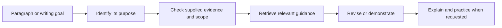

<div align="center">

# Academic Writing Coach

### Revise with purpose. Explain the choice. Practice the move.

**Agent Skill · MIT · Python 3.10+ · v0.1.0**

[Overview](#overview) · [Examples](#examples) · [Workflow](#workflow) · [Install](#install) · [Usage](#usage) · [Sources & license](#sources--license)

**English** | [简体中文](README.zh-CN.md)

</div>

---

Academic Writing Coach helps an agent revise English academic paragraphs, explain expression choices, and give writers focused practice. It combines a short [skill specification](SKILL.md), **24 original coaching cards across 12 topics**, and local search tools. Explanations can be in English or Chinese.

The package works immediately with its built-in coaching cards. Full-text reference collections can be supplied separately by the user through local import and searched alongside those cards.

## Overview

Good academic editing starts with what a paragraph needs to accomplish and what the evidence supports. This skill helps an agent make those decisions before choosing a phrase.

| Mode | Bring | Receive |
|---|---|---|
| **Lookup** | A writing purpose, relationship, or expression problem | A few relevant options with conditions for using them |
| **Revise** | A paragraph and any necessary research context | A revision that preserves the supplied facts, with explanations when requested |
| **Teach** | A writing move you want to learn | A short explanation, demonstration, practice task, and feedback on your attempt |

The 12 topic families cover introductions, literature synthesis, methods, results, discussion, conclusions, cautious wording, critical evaluation, definitions, comparison, causality, and transitions. Each family has two original coaching cards explaining writing decisions and their use in context.

### Editing principles

| Principle | What the agent should do |
|---|---|
| **Purpose before phrasing** | Identify the paragraph's job and the relationship between its statements. |
| **Evidence before emphasis** | Keep numbers, citations, scope, technical meaning, and uncertainty consistent with the draft. |
| **Relevant guidance on demand** | Retrieve a few useful cards instead of loading the entire collection. |
| **Explanation that transfers** | Explain the reason for a material edit and offer a new practice context when useful. |

The writer remains the authority on the research. The skill does not establish novelty, verify references, certify methods, or guarantee publication. Its effect on writing quality or learning has not yet been measured in a controlled study.

## Examples

These are invented teaching examples, not research findings or evaluation results.

| Writing problem | Draft | Possible revision | Why it helps |
|---|---|---|---|
| A comparison is present but its relationship is unclear. | “Study A uses interviews. Study B uses surveys. They have different evidence.” | “Study A uses interviews, whereas Study B uses surveys.” | Makes the methodological contrast explicit without adding an analysis operation. |
| An observation becomes an unsupported causal claim. | “Attendance was higher among students who used the reminder. The reminder caused higher attendance.” | “Students who used the reminder had higher attendance.” | Keeps the supplied observation and removes the unsupported causal inference. |
| A transition announces a topic without connecting it to the preceding result. | “The cache reduced processing time and increased operating cost. Next, we discuss cost.” | “Having reported the processing-time reduction, we next examine the cache's additional operating cost.” | Connects the next topic to the supplied result without claiming that the benefits offset the cost. |

Actual revisions depend on the surrounding text and the evidence the writer supplies. A request for final text only produces a clean revision rather than an unsolicited lesson.

## Workflow



The shared instructions live in [SKILL.md](SKILL.md). The [revision rubric](references/revision-rubric.md) supports substantial edits, and [moves.json](references/moves.json) contains the original coaching cards. The agent should read only what the current task needs.

## Install

### Requirements

- An agent that can load a local skill directory and read its supporting files.
- **Python 3.10 or later** for installation, search, and optional local import. The scripts use the Python standard library; no package installation or network service is required.

The instructions and coaching cards can also be read directly without Python. The installer provides Codex and Claude directory targets. Package structure and local tools are checked; end-to-end integration with every agent release is not claimed.

### Download and install locally

Download this repository as a ZIP, extract it, and open a terminal in the extracted repository directory—the directory containing `SKILL.md` and `scripts/`. Run one command for your target:

```bash
# Codex
python scripts/install.py --target codex

# Claude
python scripts/install.py --target claude
```

The same commands work in PowerShell and a POSIX shell. Use your Python 3.10+ executable, such as `python3`, if it has a different name on your system.

| Target | Default destination |
|---|---|
| Codex | `$CODEX_HOME/skills/academic-writing-coach` when `CODEX_HOME` is set; otherwise `~/.codex/skills/academic-writing-coach` |
| Claude | `~/.claude/skills/academic-writing-coach` |
| Custom | `<destination>/academic-writing-coach` |

To install into a project or another skills directory:

```bash
python scripts/install.py --target codex --destination ../my-project/.agents/skills
```

`--destination` specifies the parent skills directory, not the final `academic-writing-coach` directory. The installer refuses to overwrite an existing installation. Keep any private corpus outside the installation directory so it is independent of skill updates.

To install manually, copy this package to an `academic-writing-coach` directory inside your agent's skills directory. Preserve `SKILL.md`, `references/`, `scripts/`, and the accompanying source and license notices. Confirm that the final path is `<skills-directory>/academic-writing-coach/SKILL.md`.

## Usage

After your agent discovers the installed skill, try a request such as:

```text
$academic-writing-coach Revise this literature review paragraph. Clarify how the studies relate, preserve all citations, and explain the two most useful changes.
```

```text
$academic-writing-coach 帮我判断这段讨论需要表达对比、解释还是限定。给出英文修订稿，并用中文说明措辞选择。
```

```text
$academic-writing-coach Teach me to distinguish a reported result from an interpretation. Give me a short exercise, then wait for my answer.
```

The `$academic-writing-coach` form is for explicit invocation in Codex. Use your other agent's skill selection mechanism where its syntax differs.

### Search without an agent

Run these commands from the package directory:

```bash
python scripts/lookup.py search "literature synthesis 文献综合" --limit 4 --dataset builtin --json
python scripts/lookup.py get literature.compare-evidence --json
python scripts/lookup.py status
```

Search accepts English and Chinese terms. Use the IDs returned by search with `get` to read a complete card. `--dataset builtin`, `local`, or `all` selects the source of search results.

## Optional local reference collection

The importer accepts a local `content.json` produced by the companion Phrasebank archive workflow, containing page context, source URLs, and section content. Imported reference material is stored in a separate data directory and can be retrieved alongside the built-in coaching cards.

Keep the data directory outside this repository and outside the installed skill. For example, in PowerShell:

```powershell
python scripts/import_local.py --input "D:\my-reading\content.json" --data-dir "D:\my-private-writing-data"
python scripts/lookup.py search "literature review" --dataset local --data-dir "D:\my-private-writing-data" --json
```

Or in a POSIX shell:

```bash
python scripts/import_local.py --input "$HOME/my-reading/content.json" --data-dir "$HOME/my-private-writing-data"
python scripts/lookup.py search "literature review" --dataset local --data-dir "$HOME/my-private-writing-data" --json
```

Use your actual saved file path. Import refuses an existing corpus unless you explicitly add `--replace`. That option replaces the imported corpus; it is not an installation update command.

To connect the corpus when making a new installation, pass the existing private directory:

```bash
python scripts/install.py --target codex --data-dir /path/to/my-private-writing-data
```

Alternatively, pass `--data-dir` to lookup commands or set the `ACADEMIC_WRITING_COACH_DATA_DIR` environment variable. The built-in cards remain usable without any imported data. Private data and local installation configuration are excluded from the public release builder.

## Sources & license

[Academic Phrasebank](https://www.phrasebank.manchester.ac.uk/), created by **John Morley at the University of Manchester**, provides academic expressions and writing guidance organized by paper section and communicative purpose. It is a reference resource for this project's writing topics and local reference-library workflow. Links to individual topics are collected in [SOURCES.md](SOURCES.md).

This package contains independently written skill instructions, coaching cards, examples, tools, and documentation, released under the [MIT License](LICENSE). External resources and user-imported material remain subject to their respective copyright and terms of use. License scope is documented in [THIRD_PARTY_NOTICES.md](THIRD_PARTY_NOTICES.md).

The bilingual README organization was inspired by [Kiterlin/anti-defensive-writing](https://github.com/Kiterlin/anti-defensive-writing).

## Repository layout

```text
academic-writing-coach/
├── SKILL.md                 # Agent instructions
├── agents/openai.yaml       # Codex display metadata
├── references/              # Original cards and revision rubric
├── scripts/                 # Search, import, installation, and release tools
├── tests/                   # Local tool checks
├── docs/PUBLISHING.md       # Release and GitHub upload instructions
├── README.md
├── README.zh-CN.md
├── SOURCES.md
├── THIRD_PARTY_NOTICES.md
├── LICENSE
└── VERSION
```

## Verify and publish

Run these development commands from the source ZIP or a repository checkout. The portable runtime `.skill` archive includes the installer and coaching resources; it omits the source-only test and release tooling. It can be extracted as a ZIP and installed with `python scripts/install.py --target codex`.

```bash
python -m unittest discover -s tests -v
python scripts/build_release.py --output ../release-artifacts
```

Use the generated public archive for distribution. See [the publishing guide](docs/PUBLISHING.md) for GitHub upload steps and checks. Building an archive does not publish it or create a GitHub repository.

Contributions should improve a concrete writing decision or a reproducible tool behavior. Supply original examples and expected behavior, with source and license information for any additional resources.
